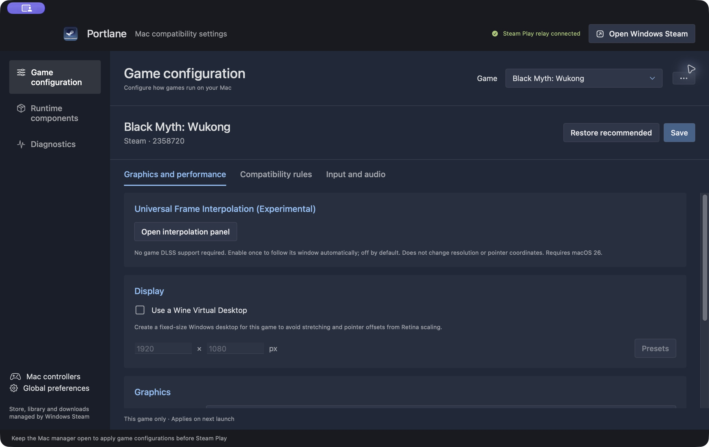

<div align="center">
  
  <h1>Portlane · 引航</h1>
  <p><strong>在 Mac 上使用 Windows Steam，为每款游戏配置专属兼容设置。</strong></p>
  <p>对象空间音频 · 7.1.4 输出验证 · Apple Silicon · Wine · D3DMetal</p>
  <p><a href="README.md">English</a> · 简体中文</p>
</div>

Portlane 管理 Windows Steam 游戏在 Mac 上运行所需的环境。浏览商店、安装游戏、管理下载和点击“开始游戏”，都在官方 Windows Steam 中完成；图形后端、兼容规则、手柄适配和启动诊断，由 Portlane 管理。

**空间音频是 Portlane 的核心特点。** 我们将 Windows 游戏的对象空间音频接入 macOS 原生音频渲染，保留声音的位置与高度信息，并已在本机验证 7.1.4 输出链路。用户实机确认《黑神话：悟空》的全景声渲染正常。

游玩时保持 Portlane 打开。顶部显示 **Steam Play relay connected（Steam 启动衔接已连接）** 后，从 Steam 桌面界面启动受支持的游戏，会先应用该游戏保存的 Mac 配置。



## 核心特点：Windows 游戏空间音频

Portlane 的空间音频运行时支持游戏通过 **Windows Spatial Audio** 提交静态声床与动态音频对象，再由 **macOS CoreAudio Spatial Mixer** 渲染。声音对象的位置与音频数据同步传递，设备的原生声道顺序和顶部方向标签得到保留，让支持对象音频的 Windows 游戏在 Mac 上使用空间渲染路径。

- **包含高度方向的多声道输出：** 本机已验证 7.1.4（12 声道、48 kHz）端点渲染链路，并测试 5.1.2 布局与立体声回退。
- **真实游戏验证：** 《黑神话：悟空》已由用户实机确认全景声渲染正常；《双影奇境》在空间音频服务版运行时和 7.1.4 输出下完成短测，画面、操作和声音正常。
- **运行时验证：** `11.0.9-services.1` 在 7.1.4 输出下执行 3,090 项空间音频检查，0 失败、0 跳过，保留 2 项既有 todo。
- **逐游戏诊断：** 可以为单款游戏启用空间音频诊断日志，检查端点、对象容量与渲染状态。

首次准备环境时，应用会自动下载包含空间音频补丁的 `11.0.9-services.1` Wine，无需手动导入。在 macOS 中配置输出设备，并在支持的游戏中启用空间／全景声音频选项。已有安装保留原先选用的运行时，可在 **运行组件** 中安装并选择服务版。

支持范围是 Windows 对象音频到 CoreAudio 的渲染；游戏需要实际提交空间对象，多声道设备需要暴露正确的声道布局。Dolby Atmos 编码直通和头部追踪尚未实现，实体扬声器方向、设备切换与长时间运行仍需进一步验收。

实现源自 Switchyard Wine 的空间音频补丁，并针对本项目运行时进行了适配与验证。详见 [实现与来源](docs/SPATIAL_AUDIO.md)、[验证记录](docs/SPATIAL_AUDIO_VALIDATION.md)。

## Steam 与 Portlane 的分工

| 官方 Windows Steam | Portlane |
| --- | --- |
| 商店、购买与账户登录 | Mac 运行环境安装和组件管理 |
| 游戏库、安装、更新与下载 | 每游戏独立的图形、同步和显示设置 |
| 开始游戏、成就与 Steam Input | DLL 覆盖、环境变量与手柄桥接 |
| 游戏属性中的 Steam 启动参数 | 在受管理的 Steam 启动前应用 Mac 配置 |

主界面保留三个页面：**游戏配置、运行组件、诊断**。侧栏还提供 **Mac 手柄** 和 **全局偏好设置**。本地 Windows EXE 也可以导入并单独配置。

## 开始使用

### 环境要求

- Apple Silicon（M 系列）Mac，macOS 15 或更高版本。
- 可访问组件下载服务器的网络，以及足够的组件和游戏存储空间。
- 自己的 Steam 账户与合法拥有的游戏。
- 从源码构建需要 Xcode 26 和兼容的 Swift 6 工具链。涉及 macOS 26 API 的功能需要 SDK 26 或更高版本才能编译。

下载 [Portlane 0.5.1 DMG](https://github.com/Tianyulife/portlane/releases/download/v0.5.1/Portlane-0.5.1-macOS-arm64.dmg) 和 [空间音频 Wine 11.0.9-services.1](https://github.com/Tianyulife/portlane/releases/download/v0.5.1/portlane-wine-11.0.9-services.1-macos-x86_64.tar.xz)。完整资源与 SHA-256 校验文件见 [Release 页面](https://github.com/Tianyulife/portlane/releases/tag/v0.5.1)。

1. 打开 DMG，将 **Portlane** 拖到 **Applications（应用程序）**，再从应用程序目录打开。
2. 完成首次环境准备，应用自动下载并校验空间音频 Wine `11.0.9-services.1`。
3. 手动或离线安装也可以：解压单独提供的 Wine `.tar.xz`，在 **运行组件 → 导入本地 Wine** 中选择 `wine-runtime` 文件夹，再选为活动运行时。

安装包是尚未公证的 ad-hoc 签名研究预览版。应用默认下载空间音频 Wine，首次环境准备需要联网；Release 也单独提供同一运行时用于手动导入。

### 编译并打开

```bash
git clone https://github.com/Tianyulife/portlane.git
cd portlane
scripts/build-app.sh
open "dist/Portlane.app"
```

构建脚本会准备 Steam WebHelper 包装器、打包资源并检查应用签名。存在 MinGW 时使用它编译，否则校验并使用仓库内的预编译包装器。本地构建采用 ad-hoc 签名，尚未公证。

生成经过签名、资源和挂载检查的 DMG：

```bash
scripts/build-dmg.sh
```

需要分发签名时，通过 `MAC_GAMING_UNCLE_CODESIGN_IDENTITY` 指定自己的 Developer ID。为保持兼容，源码包、可执行文件及构建变量仍保留历史名称。

### 配置 Steam 并游玩

1. 打开 Portlane，完成首次运行环境安装。应用安装或导入 Wine 和图形组件，然后打开官方 Windows Steam 登录流程。
2. 登录 Windows Steam。它与原生 macOS Steam 的登录状态相互独立。
3. 在 Windows Steam 中安装游戏，再回到 Portlane 的 **游戏配置** 中选择它。未显示时，在 **更多操作** 中重新扫描 Steam 游戏。
4. 按需调整配置，点击 **保存**。第一次运行可以先使用默认值和内置推荐。
5. 等待 **Steam 启动衔接已连接**，然后在 Windows Steam 中点击 **开始游戏**。配置修改在下次启动时生效。

关闭 Portlane 前先保存并退出游戏：退出管理应用也会关闭它管理的 Steam 会话。

## 可以调整什么

- **图形与性能：** 渲染后端、同步方式、虚拟桌面及分辨率、Apple Metal HUD、MetalFX/DLSS 映射和 Metal 4 偏好。
- **兼容规则：** 每游戏独立的 DLL 加载规则和环境变量。Steam 游戏的启动参数仍在 Steam 游戏属性中设置，本地 EXE 参数由 Portlane 管理。
- **输入与音频：** 手柄选项、空间音频运行时支持与逐游戏诊断；设备管理在 **Mac 手柄** 页面中进行。
- **运行组件：** Wine 和图形组件的安装、导入、选择与检查，以及高级 Bottle 和本地目录工具。
- **诊断：** 系统检查、Steam 启动衔接状态、启动错误与运行日志。

目前 Steam 游戏共享一个 Steam Bottle，但各游戏配置分别保存。修改 Bottle 全局环境可能影响其中所有游戏；启动配置冲突时可能需要重启 Steam，有游戏正在运行或正在下载时，Portlane 会阻止这类重启。本地导入的程序使用独立 Bottle。

**黑神话：悟空** 保留已验证的内置 `mscoree=b` 兼容规则。**恢复推荐** 会清除自定义覆盖，同时保留游戏内置规则。本地已验证 Steam 启动衔接和游戏运行，包括空间音频渲染；该结果不能保证所有 Mac、游戏版本或音频设备都有相同表现。

MetalFX/DLSS 映射与通用插帧属于实验功能，默认关闭。DLSS 映射需要游戏自身支持；插帧原型需要 macOS 26，不保证帧率翻倍。详见 [插帧说明](docs/FRAME_INTERPOLATION.md) 与 [空间音频说明](docs/SPATIAL_AUDIO.md)。

## 启动如何衔接

```text
Windows Steam：开始游戏
        ↓
Portlane：读取该游戏配置与兼容配方
        ↓
Steam：通过 -applaunch 启动
        ↓
Wine + Rosetta 2 + 图形转译 → macOS / Metal
```

衔接覆盖本机发现的受管理 AppID，以及支持的 Steam 桌面“开始游戏”调用。直接执行 EXE、外部快捷方式和该界面之外的 Steam URI 启动不在覆盖范围内。连接使用 Steam 客户端私有 API，可能随 Steam 更新而变化；异常会显示在诊断页。管理应用失去响应时，短期租约到期后会恢复 Steam 原有启动行为。详见 [Mac 管理应用架构](docs/mac-companion.md)。

## 开发与验证

```bash
swift test
node scripts/test-steam-launch-relay.mjs
node scripts/test-steam-bridge.mjs
node scripts/test-steam-presentation.mjs
swift build -c release
swift run macgamingunclectl --json doctor
```

最近一次本地 Swift 测试执行 118 项，4 项可选集成测试跳过，无失败。启动衔接回归测试覆盖拦截、重复请求、非受管理调用、重连和租约过期；Release 构建及打包资源、签名检查也已通过。这些验证不代表所有 Steam 更新与游戏版本都兼容。

更多资料：[架构说明](docs/ARCHITECTURE.md)、[运行时供应链](docs/RUNTIME_SUPPLY_CHAIN.md)、[测试指南](docs/TESTING.md)、[GPTK 下载与导入](docs/GPTK_DISTRIBUTION.md)。

应用保留原有 Bundle ID 和数据目录，使更名为 Portlane 后仍可沿用已有 Steam 登录、运行组件和游戏配置。仓库保留上游历史及署名；部分旧文档描述的是原界面，当前页面组织以本 README 和 Mac 管理应用架构说明为准。

## 项目状态与参与

Portlane 处于兼容性研究预览阶段。支持情况因游戏和硬件而异，内核级反作弊、Windows 驱动和部分 DRM 仍不兼容。Wine 进程使用当前用户权限运行。Steam、游戏和 Apple 图形组件遵循各自许可，单独安装或导入。

欢迎在 [Issues](https://github.com/Tianyulife/portlane/issues) 提交可复现的问题，附上 Mac 型号、macOS 版本、Steam AppID、图形后端／运行时版本，以及去除个人信息的相关日志。也欢迎改进兼容配方、测试和界面。

项目继续遵守非商业化承诺：不推出收费版、订阅、广告、付费兼容名单、游戏抽成或用户数据交易。这是项目运营方向，不改变源码许可证。

## 许可证与署名

项目源码使用 [Apache License 2.0](LICENSE)。第三方组件与图案保留各自权利和使用条款，见 [第三方声明](THIRD_PARTY_NOTICES.md)。Steam 与 Steam 图标属于 Valve。Portlane 是独立项目，不隶属于 Valve、Apple 或 CodeWeavers。
